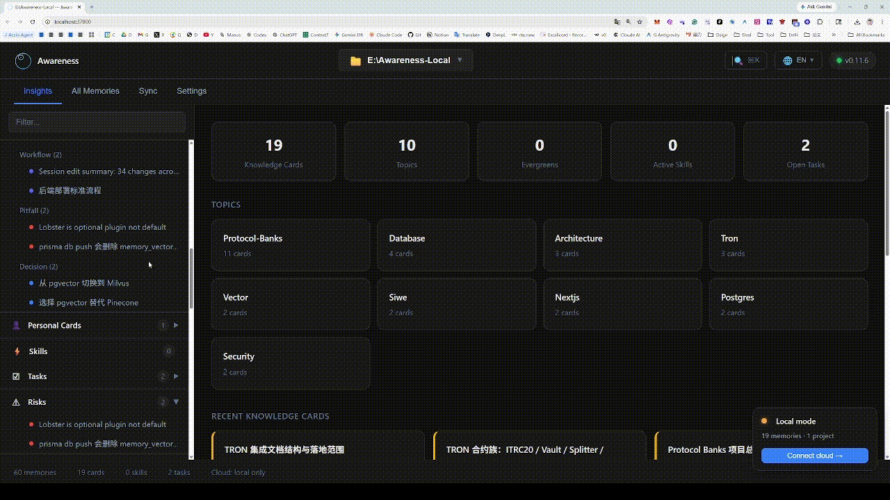

# Awareness Market — Solana

## Solana Devnet 版本

本仓库基于 [everest-an/Awareness-Market](https://github.com/everest-an/Awareness-Market) 的提交 [`14f11d3`](https://github.com/everest-an/Awareness-Market/commit/14f11d3172e6496146ad50a38c62c52657fd0be8) 扩展，保留原项目 MIT 许可证和版权声明。新仓库从干净的源码快照开始，不包含本地记忆、日志、凭据和生成的测试数据。

程序 [`9RQqnFRPg2z7XNtggHLTnw3sREjwivB88mXZjuMnvxit`](https://explorer.solana.com/address/9RQqnFRPg2z7XNtggHLTnw3sREjwivB88mXZjuMnvxit?cluster=devnet) 已于 **2026 年 10 月 10 日部署至 Solana Devnet**。详见[部署记录](reports/solana-devnet-deployment.md)和[合约源码](contracts/solana/README.md)。记忆正文与私有 witness 保留在本地，仅承诺与状态根上链。

请克隆本仓库，按照 [Solana 指南](docs/solana-devnet.zh-CN.md)从本地源码运行。下文 npm 安装命令对应上游发行包，不会安装本仓库新增的 Solana 功能。本仓库设置了 npm 的 private 标记，防止以原项目包名误发布；这不影响 GitHub 仓库的 Public 可见性。

<p align="center">
  <strong>语言:</strong> 简体中文 | <a href="./README.md">English</a>
</p>

<p align="center">
  <picture>
    <source media="(prefers-color-scheme: dark)" srcset="assets/branding/awareness-wordmark-dark.svg" />
    
  </picture>
</p>

<p align="center">
  <a href="https://arxiv.org/abs/2410.10813"></a>
  <a href="https://awareness.market/"></a>
  <a href="https://awareness.market/docs"></a>
  <a href="https://discord.com/invite/BMjkCKeqnJ"></a>
  <a href="https://t.me/awarenessmarket"></a>
  <a href="LICENSE"></a>
</p>

<p align="center">
  
</p>

**给你的 AI 编程助手加上持久记忆。一个命令即可，本地优先，无需账号。**

Awareness Local 是一个面向 AI 编程代理的本地优先 MCP 记忆服务。它为 Cursor、Claude Code、Copilot、Cline 等 MCP IDE 提供跨会话持久记忆、语义+关键词混合检索，以及可复用的知识卡片能力。

它在你的机器上运行轻量守护进程，以 Markdown 方式存储记忆，使用 SQLite FTS5 + 向量混合检索，并通过 MCP 协议接入 IDE，让 AI 工作流更连贯、更可解释、可离线。

可选的 Solana 原生记忆锚定：参见 [Devnet 部署与演示指南](docs/solana-devnet.zh-CN.md)。链上保存授权提交的记忆承诺与连续状态根，记忆正文和私有 witness 保留在本地。

```bash
npx @awareness.market/setup
```

就是这么简单。你的 AI 代理可以跨会话记住上下文。

---

## 为什么选择 Awareness Local

AI 编程代理常见问题是会话结束后上下文丢失。Awareness Local 让代理在下一次会话中继续沿用历史决策、未完成任务、编码约束与项目背景，无需重复解释。

- 面向 AI 编程的持久记忆
- 本地优先 MCP 服务，支持离线
- 关键词 + 语义混合检索
- 自动提炼知识卡片（决策、方案、风险）

## 快速开始

```bash
npx @awareness.market/setup
```

执行后即可在 IDE 中使用 recall / record / init 等记忆工具。

## 常见使用场景

- 跨多次会话的重构与迁移项目
- 团队协作中 AI 接续上下文与历史决策
- 个人长期项目中的偏好、约定与任务沉淀
- 多代理协作共享记忆与知识卡片

## 常见问题

### 支持离线吗？

支持。Local 模式可完全离线运行。

### 数据存在哪里？

默认存储在 `.awareness/`，记忆为 Markdown，检索索引为本地 SQLite。

### 必须使用云端吗？

不需要。云同步是可选能力，可后续按需开启。

### 支持哪些 IDE？

支持所有 MCP 兼容 IDE，包括 Cursor、Claude Code、Copilot、Cline、Windsurf 等。ChatGPT 桌面版：设置 → MCP 服务器 → 添加 → Streamable HTTP → `http://127.0.0.1:37800/mcp`（仅本地 daemon，无需认证）。

## 导航

- [核心能力](#核心能力)
- [常用工具](#常用工具)
- [要求](#要求)
- [链接](#链接)

## 核心能力

- 本地优先记忆存储（Markdown，可读、可编辑、可 Git 管理）
- 混合检索（SQLite FTS5 + 语义向量）
- MCP 工具接入多种 IDE
- 自动提炼知识卡片（决策、方案、风险）
- Web 控制台： http://localhost:37800/
- 可选云同步（跨设备与团队协作）

## 常用工具

- awareness_init: 加载会话上下文
- awareness_recall: 召回记忆（摘要/全文两阶段）
- awareness_record: 记录决策、代码变更与洞察
- awareness_lookup: 快速查任务、知识卡片、会话历史
- awareness_get_agent_prompt: 多代理场景下获取提示词

## 要求

- Node.js 20+
- 任意支持 MCP 的 IDE

## 链接

- 官网： https://awareness.market/
- 文档： https://awareness.market/docs
- Discord： https://discord.com/invite/BMjkCKeqnJ
- 英文完整说明： [README.md](./README.md)

## 许可证

MIT
